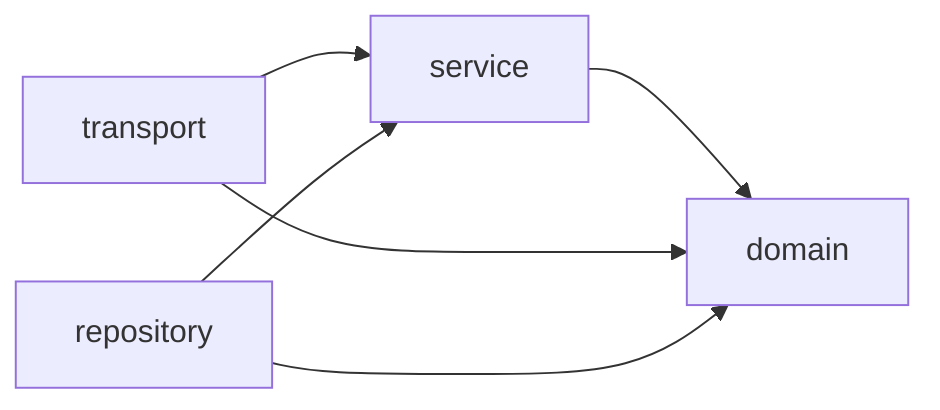
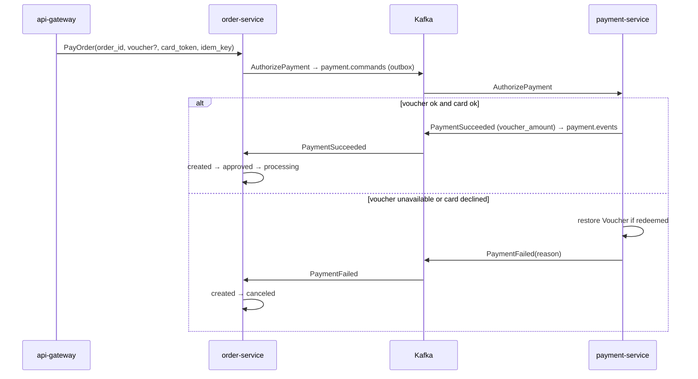
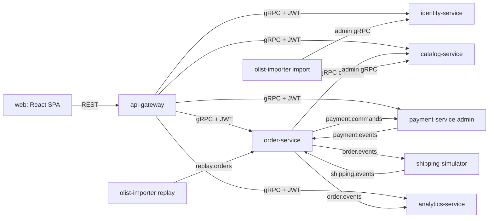

# Architecture Spine — olist-marketplace

## Design Paradigm

**System:** event-driven microservices. Each service owns its data. Services cooperate through Kafka, with gRPC only where an immediate answer is required.

**Inside each service:** hexagonal (ports & adapters), using the existing folders:

| Folder | Role | May import |
| --- | --- | --- |
| `internal/domain` | Entities, value objects, business rules | nothing internal |
| `internal/service` | Use cases; defines the ports (interfaces) it needs | `domain` |
| `internal/repository` | Postgres adapters implementing service ports | `service`, `domain` |
| `internal/transport` | gRPC/HTTP handlers, Kafka consumers | `service`, `domain` |
| `cmd/server` | Wiring only | everything |



## Invariants & Rules

### AD-1 — Service boundaries and data ownership [ADOPTED]

- **Binds:** all
- **Prevents:** two services owning, or writing, the same entity.
- **Rule:** Each entity has exactly one owner, which is its only writer:

| Service | Owns |
| --- | --- |
| identity-service | Account (all roles), credentials, signing keys |
| catalog-service | Product (incl. derived display name, price, freight), Category, Seller profile (incl. state) |
| order-service | Order, Order Item (new and Historical), status timeline, Order Saga state, payment requests |
| payment-service | Payment, Voucher, simulated card gateway settings |
| shipping-simulator | Shipment (own database) |
| analytics-service | Read models only (Seller Revenue, dashboard aggregates) |
| api-gateway | No data |

`review-service` is removed. `customer-service` becomes `identity-service`.

### AD-2 — Database per service, enforced by credentials [ADOPTED]

- **Binds:** all services, NFR-5
- **Prevents:** cross-service SQL reads or writes that bypass APIs and events.
- **Rule:** One Postgres instance, with one database and one DB user per service. A user has no grants on any other database. Each service keeps its own `migrations/` and applies them at startup with golang-migrate. No process other than the owner, including tools, runs SQL against a service's database.

### AD-3 — Communication matrix [ADOPTED]

- **Binds:** all
- **Prevents:** synchronous calls on paths that must survive a service outage (NFR-1), and services inventing their own transport.
- **Rule:**

| From → To | Transport |
| --- | --- |
| Browser → api-gateway | REST/JSON |
| api-gateway → services | gRPC (contracts in `proto/<service>/v1`) |
| order-service → catalog-service at Checkout | gRPC; snapshot into Order Item (AD-15) |
| order-service → payment-service (saga command) | Kafka `payment.commands`, via outbox |
| payment-service → order-service (saga reply) | Kafka `payment.events` |
| order-service → shipping-simulator → order-service | Kafka `order.events` / `shipping.events` |
| order-service → analytics-service | Kafka `order.events` |
| replayer → order-service | Kafka `replay.orders` |
| olist-importer → catalog / identity | gRPC admin import RPCs (AD-12) |

No other synchronous service-to-service call is allowed.

### AD-4 — Order Saga is orchestrated by order-service [ADOPTED]

- **Binds:** FR-1–FR-4, NFR-1
- **Prevents:** saga logic spread across services, an unclear entry point for paying, and an unclear owner of compensation.
- **Rule:**
  - Checkout (FR-1) does not start the saga.
  - Paying (FR-2) enters only through `OrderService.PayOrder`. order-service checks that the caller owns the Order and that it is `created`, then writes `AuthorizePayment` to its outbox.
  - payment-service exposes no gRPC for paying. Its gRPC surface is Voucher admin (FR-19) and the gateway decline-rate setting.
  - payment-service redeems a Voucher with one conditional update (`… SET used_by_order = $order WHERE code = $code AND used_by_order IS NULL`). Zero rows updated means `PaymentFailed{reason: VOUCHER_UNAVAILABLE}`.
  - When the card declines, payment-service restores the Voucher itself (only if `used_by_order` equals this Order), then emits `PaymentFailed`.
  - Any `PaymentFailed` moves the Order to `canceled`.
  - Shipping and analytics react by choreography.



### AD-5 — Only order-service mutates Order Status

- **Binds:** FR-3, FR-5–FR-7, FR-18
- **Prevents:** two services writing Order Status and drifting apart.
- **Rule:** Other services publish facts (`PaymentSucceeded`, `ShipmentDelivered`). order-service validates each transition and is the only writer. Allowed transitions: `created→approved→processing→shipped→delivered` and `created→canceled`. A Historical Order's first event may be any status, but later events must be forward-reachable. Unpaid `created` Orders do not expire. Every transition is stored in a status timeline with its business timestamp (FR-7).

### AD-6 — Transactional outbox with ordered polling relay [ADOPTED]

- **Binds:** every service that publishes, NFR-1, NFR-2
- **Prevents:** state saved but event lost; event sent for rolled-back state; events for one Order published out of order.
- **Rule:**
  - A service writes its state change and its outbox row (with a `bigserial seq` and the current `traceparent`) in one DB transaction. Publishing directly to Kafka from a use case is forbidden.
  - One relay goroutine per service publishes unsent rows in `seq` order. It uses `SELECT … FOR UPDATE SKIP LOCKED` only to guard against a second instance, never to parallelize.
  - The producer is idempotent with `acks=all`, in franz-go's ordered mode.
  - The relay polls every ≤ 200 ms (env).

### AD-7 — Idempotent consumers, handler outcomes, and request keys [ADOPTED]

- **Binds:** every Kafka consumer, FR-1, FR-4, FR-18, NFR-2
- **Prevents:** double effects from at-least-once delivery, retried requests, or a restarted Replay; stalled partitions.
- **Rule:**
  - **Inbox.** Each consumer records `event_id` in `processed_events` and applies its change in one transaction. A known `event_id` is skipped.
  - **Handler outcomes.** Each handler returns one of four outcomes:
    - `applied`
    - `duplicate`
    - `rejected`: domain-invalid. Record it with a reason, ack it, and count it in a metric.
    - `retryable`: an infrastructure error. Back off and do not commit. After N tries, send it to `<topic>.dlq`.
  - **Projectors** upsert per `(order_id, status)` and never decrement a count below 0.
  - **Payment requests.** `PayOrder` stores `payment_requests(idempotency_key PK, order_id, request_hash)`.
    - Same key, different hash: `ALREADY_EXISTS`.
    - Order not `created`, or a payment already in flight: `FAILED_PRECONDITION`.
    - payment-service enforces `UNIQUE(order_id)` on Card Payment and Voucher redemption.
  - **Checkout requests** carry a `checkout_idempotency_key`. All Orders of one Checkout, plus their outbox rows, are written in one transaction and share a `checkout_id`.

### AD-8 — Topics and envelope [ADOPTED]

- **Binds:** all producers and consumers, NFR-3, NFR-4
- **Prevents:** a command published on one topic and consumed from another; broken traces; wall-clock timestamps on Historical facts.
- **Rule:**
  - Facts go on `<producer>.events`: `order.events`, `payment.events`, `shipping.events`. Commands go on `<target>.commands`: `payment.commands`. Replay input goes on `replay.orders`. A topic carries one direction only.
  - The partition key is `order_id`.
  - Envelope (JSON):
    - `event_id`, `event_type`, `event_version`, `aggregate_id`, `historical`
    - `occurred_at`: business time; the dataset timestamp for Historical events
    - `published_at`: relay time, used to measure NFR-4 lag
    - `traceparent`: W3C; also set as a Kafka header
    - `payload`
  - Consumers start a child span from `traceparent`.

### AD-9 — Event and command catalog

- **Binds:** all producers and consumers, FR-5–FR-12
- **Prevents:** teams inventing different event types or payloads; consumers depending on an earlier event they may not have seen.
- **Rule:**
  - `contracts/events/v1` (Go structs plus JSON Schema, used through `pkg/eventbus`) is the only definition of event and command types. A type that is not listed there must not be published.
  - **Order facts, one per status:** `OrderCreated`, `OrderApproved`, `OrderProcessing`, `OrderShipped`, `OrderDelivered`, `OrderCanceled`. Each carries `from_status`, `to_status` and the full Order snapshot (AD-10). When `approved→processing` happens in one transaction, it emits both `OrderApproved` and `OrderProcessing`, in that order.
  - **Payment:** command `AuthorizePayment{order_id, amount_total, voucher_code?, card_token, idempotency_key}`; facts `PaymentSucceeded` (carries `voucher_amount`) and `PaymentFailed` (carries `reason`). No card number appears anywhere; `card_token` is a simulated test value.
  - **Shipping:** fact `ShipmentDelivered`.
  - **Replay:** `HistoricalOrderStatusRecorded` (AD-12).
  - **Versioning:** adding a field is a minor `event_version` bump. Renaming or removing a field needs a new major version.

### AD-10 — Event-carried state for read models [ADOPTED]

- **Binds:** FR-9–FR-12, analytics-service
- **Prevents:** analytics calling other services; analytics depending on having seen earlier events.
- **Rule:** Every `Order*` fact carries the full current snapshot:
  - Order: `order_id, customer_id, checkout_id, purchased_at, historical, status, voucher_amount` (0 until `approved`).
  - Each item: `items[{product_id, seller_id, seller_state, category_en, price, freight}]`. `category_en` is "Uncategorized" when the Product has no Category.

  analytics-service builds projections from events only, filters date ranges on `purchased_at`, and never calls another service.

### AD-11 — Query ownership [ADOPTED]

- **Binds:** FR-7–FR-12
- **Prevents:** two services answering the same query with different numbers.
- **Rule:**
  - order-service serves Order lists and timelines (FR-7, FR-8). A Seller sees only their own Order Items of a Historical Order.
  - analytics-service serves Seller Revenue and the Ops Dashboard (FR-9–FR-12). Revenue per Order is `max(0, Σprice − voucher_amount)` for new Orders and `Σprice` for Historical Orders. It counts `delivered` Orders only.

### AD-12 — Import and Replay boundaries [ADOPTED]

- **Binds:** FR-13, FR-17, FR-18
- **Prevents:** tools coupling to private schemas; Historical Orders counted twice; order-service calling out to enrich Replay data.
- **Rule:**
  - **Import.** `tools/olist-importer` loads reference data only, through each owner's admin gRPC (`catalog.ImportProducts/Sellers/Categories`, `identity.ImportAccounts`). These are idempotent upserts keyed by dataset id. catalog derives Product display name, price and freight from the most recent dataset Order Item.
  - **Replay.** The replayer emits one `HistoricalOrderStatusRecorded` per derived status change, already enriched from the CSVs: `customer_unique_id`, `seller_state`, `category_en`, centavos. Events are sorted by status timestamp and paced by `--from`, `--to` and the speed (default 1 day per second).
  - **Status mapping:**
    - `purchase` → `created`
    - `approved_at` → `approved`
    - `invoiced` / `processing` → `processing` at `approved_at`
    - `delivered_carrier_date` → `shipped`
    - `delivered_customer_date` → `delivered`
    - `canceled` / `unavailable` → `canceled` at the last known timestamp
    - Rows with no usable timestamp are skipped and counted in a replay report.
  - **Event id.** `event_id = UUIDv5(NS_OLIST_REPLAY, order_id + ":" + status)`. The namespace is a constant in `contracts`.
  - **Ingest.** order-service ingests with `historical=true`, bypassing the saga, and re-publishes through its outbox, reusing the incoming `event_id`.

### AD-13 — Reactors ignore Historical events

- **Binds:** payment-service, shipping-simulator, any future reactor
- **Prevents:** live side effects (simulated deliveries, payments) firing for about 100k replayed Orders.
- **Rule:** Process reactors drop envelopes with `historical=true` before decoding. Only projectors (analytics, order-service's own lists) consume them.

### AD-14 — Identity, access, and trust boundary

- **Binds:** FR-14–FR-16, NFR-7
- **Prevents:** inconsistent user ids across services; direct gRPC calls that bypass the gateway; ownership checks that confuse a Customer id with a Seller id.
- **Rule:**
  - **Tokens.** identity-service signs RS256 JWTs (1 h, no refresh; claims `sub`, `role`, `kid`) and serves `GET /.well-known/jwks.json`. Passwords use bcrypt. Registration creates Customer Accounts only.
  - **Gateway.** api-gateway verifies the token and enforces role (FR-16), then forwards the original JWT in gRPC metadata.
  - **Services.** Each service re-verifies the JWT against the cached JWKS (refreshed on an unknown `kid`) and picks its ownership predicate by role: customer → `customer_id`, seller → `item.seller_id`. A non-public RPC with no valid token returns `UNAUTHENTICATED`.
  - **Network.** Service gRPC ports are not published to the host.
  - **Account ids.** Seeded Accounts use the dataset id (`customer_unique_id`, `seller_id`); new Accounts use UUIDv7. Orders reference the Account id.

### AD-15 — Money and Checkout snapshot

- **Binds:** FR-1, FR-2, FR-9–FR-11, FR-13
- **Prevents:** order-service and payment-service computing different totals; Voucher amounts recorded inconsistently.
- **Rule:** At Checkout, order-service snapshots from catalog each Product's `price`, `freight`, `seller_id`, `seller_state` and `category_en` into its Order Item. `order_total = Σ(price + freight)`. `voucher_amount` is the applied amount, `min(face, order_total)`. The card is charged `order_total − voucher_amount`. All amounts are int64 centavos.

### AD-16 — Shipping simulator is durable

- **Binds:** FR-6, NFR-1
- **Prevents:** a crash leaving an Order `shipped` forever.
- **Rule:** shipping-simulator stores `shipments(order_id PK, deliver_at, delivered)` in its own database, with inbox and outbox like every other service. A poller emits `ShipmentDelivered` once `deliver_at <= now()`. The delay comes from env `SHIPPING_DELAY` (default 3s).

### AD-17 — Read-model freshness budget

- **Binds:** NFR-4, FR-12
- **Prevents:** each hop adding latency until the dashboard falls more than 5 s behind.
- **Rule:**
  - Relay poll ≤ 200 ms.
  - analytics commits per batch, ≤ 500 ms.
  - The dashboard auto-refreshes every ≤ 2 s.
  - analytics exposes a lag metric (`now − published_at`).

## Consistency Conventions

| Concern | Convention |
| --- | --- |
| IDs | `uuid` everywhere; Olist 32-hex ids stored as uuid; new ids UUIDv7 |
| Money | `int64` centavos (BRL × 100); never float |
| Time | `timestamptz`, UTC; Olist São Paulo times converted at import/replay |
| Errors | gRPC status codes between services; gateway returns `{ "error": { "code", "message" } }` |
| Logging | `log/slog` JSON to stdout; every line has the trace id |
| Tracing | OpenTelemetry SDK in every service, OTLP to Jaeger; `traceparent` through outbox and Kafka headers |
| Health & metrics | `/healthz`, `/readyz` (DB + Kafka reachable), `/metrics` on one ops port per service |
| Config | Environment variables; payment decline rate also settable by admin gRPC for demos |
| gRPC contracts | `buf` lint + breaking-change check; generated code in `proto/gen/go` |

## Stack

| Name | Version |
| --- | --- |
| Go | 1.27.x |
| PostgreSQL (image volume at `/var/lib/postgresql`) | 18.x |
| Apache Kafka (KRaft) | 4.3.x |
| franz-go (+ kotel for tracing) | v1.22.x |
| pgx | v5.x |
| golang-migrate (iofs embed, pgx/v5 driver) | v4.20.x |
| golang-jwt | v5.x |
| golang.org/x/crypto (bcrypt) | latest |
| OpenTelemetry Go SDK | v1.47.x |
| Jaeger (`jaegertracing/jaeger` image) | v2.22.x |
| Prometheus | 3.x |
| Grafana | 13.x |
| React | 19.x |
| Vite | 8.x |
| kafbat kafka-ui | v1.5.x |

## Structural Seed



**Local runtime (the only environment in MVP):** one `docker compose` on one internal network brings up all services, one Postgres 18, one Kafka broker, Jaeger, Prometheus, Grafana and kafka-ui. Only api-gateway, web and the observability UIs publish ports (NFR-6).

```text
olist-marketplace/
  services/{api-gateway,identity-service,catalog-service,order-service,payment-service,shipping-simulator,analytics-service}/
  web/                     # React + Vite SPA
  proto/<service>/v1/      # gRPC contracts; generated code in proto/gen/go
  contracts/events/v1/     # event & command catalog (AD-9)
  pkg/{logger,tracing,eventbus,outbox,inbox}/
  tools/olist-importer/    # import + replay
  deployments/docker-compose.yml
```

## Capability → Architecture Map

| Capability | Lives in | Governed by |
| --- | --- | --- |
| FR-1 Checkout | order-service | AD-3, AD-7, AD-15 |
| FR-2–FR-4 Payment | order-service, payment-service | AD-4, AD-6, AD-7, AD-9, AD-15 |
| FR-5–FR-6 Shipping | order-service, shipping-simulator | AD-5, AD-13, AD-16 |
| FR-7–FR-8 Order lists | order-service | AD-5, AD-11, AD-14 |
| FR-9–FR-12 Revenue & dashboard | analytics-service | AD-9, AD-10, AD-11, AD-17 |
| FR-13 Browsing | catalog-service | AD-1, AD-12 |
| FR-14–FR-16 Accounts | identity-service, api-gateway, all services | AD-14 |
| FR-17–FR-18 Import & Replay | tools/olist-importer, catalog, identity, order-service | AD-7, AD-12, AD-13 |
| FR-19 Vouchers | payment-service | AD-1, AD-4 |
| NFR-1 | all publishers | AD-4, AD-6, AD-16 |
| NFR-2 | all consumers | AD-6, AD-7 |
| NFR-3 | all | AD-8, Conventions |
| NFR-4 | relay, analytics, web | AD-17 |
| NFR-5 | all | AD-2, AD-12 |
| NFR-7 | gateway, all services | AD-14 |

**NFR-3 demo path:** the Pay request (gateway → order → payment → order) plus its asynchronous consequences (shipping-simulator, analytics) forms one trace across ≥ 4 services.

## Deferred

- **Debezium CDC** replacing the polling outbox relay: after MVP (user priority).
- **OTel Collector** between services and Jaeger: not needed with one backend.
- **Kubernetes manifests:** week 8. Local compose is the only environment until then.
- **REST↔gRPC mapping inside the gateway** (hand-written or grpc-gateway): local to api-gateway, so it cannot cause cross-unit divergence.
- **Number of seeded demo Accounts and how their passwords are shared:** decided in epics.
- **Expiry of unpaid `created` Orders:** not in MVP (AD-5).
- **Stock, cart, Shopee-like features, estimated delivery:** out of MVP per PRD.
